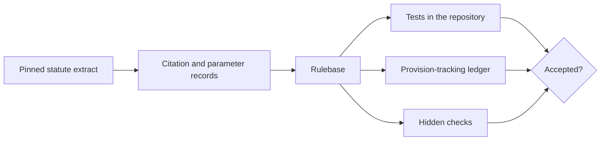

# How it is checked

A formalization that reads well can still be wrong. Each domain in this release is therefore
held to checks of ten kinds, seven of which anyone can re-run from the repository. The
[status page](status.md) shows the result of every public check for every domain.

## In the repository

| Check | What it establishes | Re-run it with |
|---|---|---|
| **Public interface tests** | Each exported predicate gives the documented answers to the documented questions. | `python run_tests.py` |
| **Query tests** | Worked cases for each kind of question the domain answers: eligibility, thresholds, what is missing. | `python run_tests.py` |
| **Property tests** | Every valid input gets exactly one verdict; monotone rules behave monotonically; related predicates agree. | `python run_tests.py` |
| **Robustness tests** | A missing, mistyped, negative or incomplete input is refused or answered "indeterminate", never guessed, and nothing crashes. | `python run_tests.py` |
| **Citations** | Every provision a rule cites has exactly one record, and every quotation matches the pinned official text word for word. | `_tools/check_citations.py <domain>` |
| **Parameters** | Every number taken from the law (a threshold, a ceiling, a number of days) has a record quoting the provision that fixes it. | `_tools/check_parameters.py <domain>` |
| **Provision tracking** | Every unit of the pinned extract (article, paragraph, point) is formalized, deferred with a reason and a consequence, or excluded from scope. Nothing is left silently unread. | `_tools/check_provisions.py <domain>` |

## Kept private on purpose

Three further checks are not published, because a test you can see is a test you can write to:

- **An independent reference implementation**, written separately from the rulebase, answers
  held-out cases; the domain must agree with it.
- **Mutation testing** injects small plausible errors into the rulebase (a `>=` turned into `>`,
  a condition dropped, a deadline shortened) and requires the reference cases to catch them.
- **Adversarial review** looks for the ways a formalization can look right and be wrong: a
  missing input silently defaulting to an answer, a rule calling something that does not exist,
  two parts of a domain that disagree, a rule testing a proxy instead of the condition the
  statute names.

Per-domain results of these checks will be added to the status page in the next release.

## What the robustness tests found, and why they are now part of the bar

Before this release, robustness tests were written for the eight domains and run against the
then-current code. Many failed: a missing value could still produce a definite answer, and some
wrongly typed values caused errors instead of a refusal. Every domain was then given a single
input check that runs before any rule decides, and the tests were kept. All of them pass now,
and the same kind of test is required of every domain that joins a release. We mention this
because a check that has never failed has not shown that it can.
